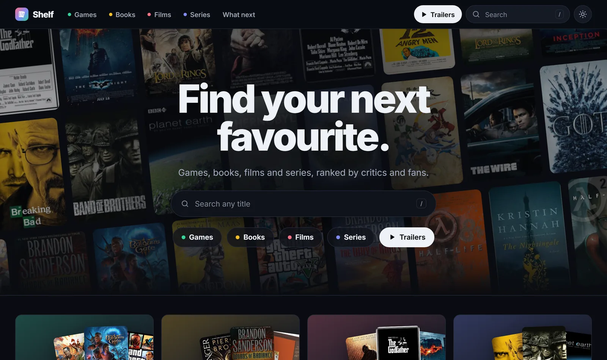
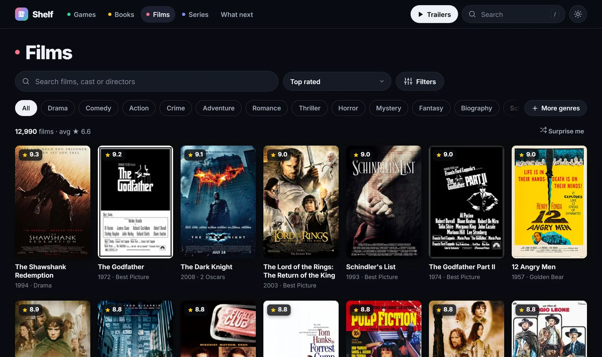
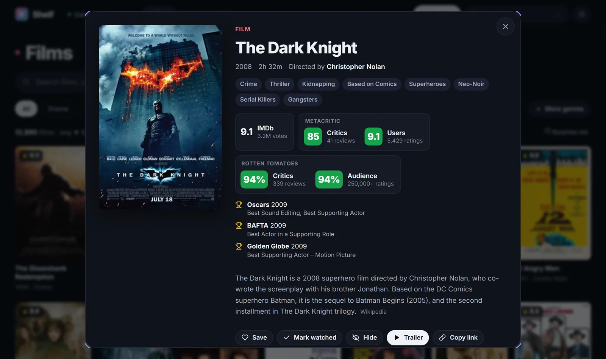
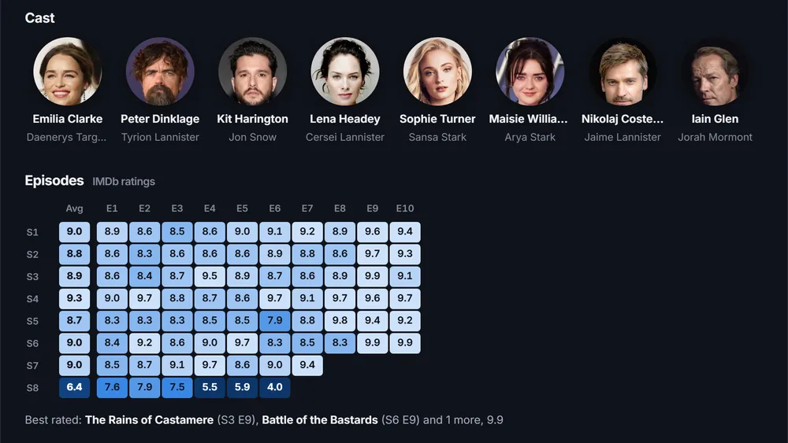
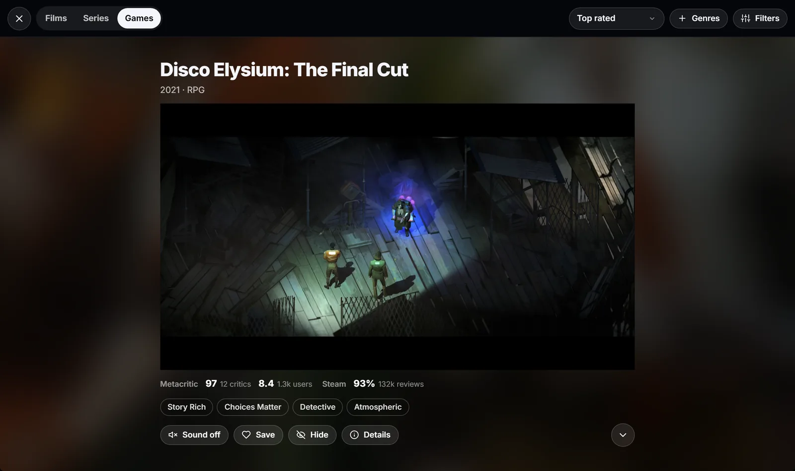
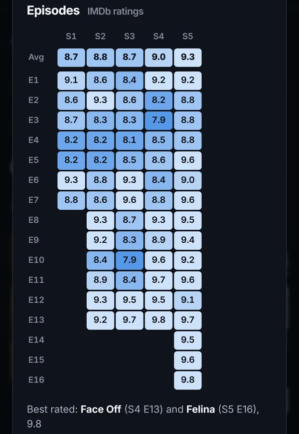
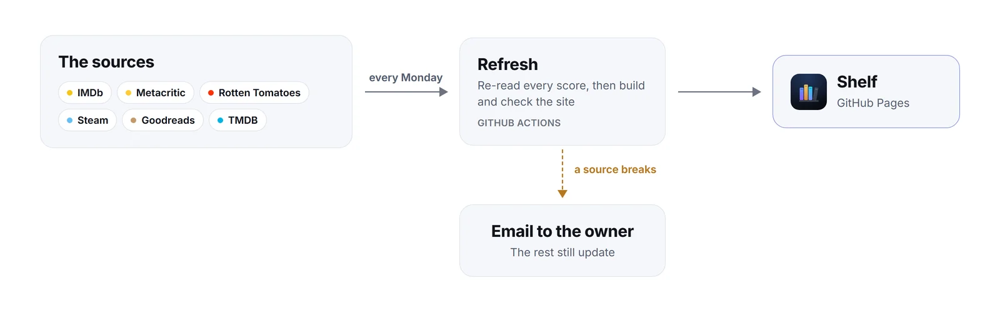

# Shelf

**Games, books, films and series in one place, ranked by the people who score them.**

IMDb · Metacritic · Rotten Tomatoes · Steam · Goodreads

&nbsp;

 

## A look around

<table>
  <tr>
    <td width="50%" valign="top">
      
       <b>Ranked shelves</b>
       Every film and series with 10,000+ IMDb votes, books with 10,000+ Goodreads ratings, and PC games by Metacritic and Steam.
    </td>
    <td width="50%" valign="top">
      
       <b>Every score, with its count</b>
       IMDb, Metacritic critics and users, Rotten Tomatoes critics and audience, and the awards a title won.
    </td>
  </tr>
  <tr>
    <td width="50%" valign="top">
      
       <b>Cast and episodes</b>
       Who plays whom, with photos, and every episode's rating, season by season.
    </td>
    <td width="50%" valign="top">
      
       <b>Trailer feed</b>
       Full-screen trailers for films, series and games, filtered like the shelves.
    </td>
  </tr>
</table>

<table>
  <tr>
    <td width="34%" valign="top">
      
    </td>
    <td valign="top">

### Also on board

- **Filters that count.** Genres, themes, countries, years, length, awards, a minimum rating and a minimum number of votes, each showing how many titles it leaves.
- **Follow a person.** Tap anyone in the cast, or a director, for everything else they are in.
- **From cinema to sofa.** A film in cinemas shows when it comes to digital, streaming and Blu-ray, and Filters lists what is in cinemas now.
- **Your shelf, no account.** Save, hide or mark titles watched, or bring in your Letterboxd, IMDb or Goodreads history. It all stays in your browser.
- **What next.** Drop in a watchlist or a to-read export and get it ranked by score and the time you have.
- **Quick everywhere.** Pages arrive already drawn, book covers come from the site itself, and pages you have visited open offline.

</td>
  </tr>
</table>

## Where the scores come from

Every number is read from its source by `scripts/refresh/`. Nothing is typed in, and a score the pipeline cannot read stays empty.

| Source | Gives |
| --- | --- |
| **IMDb** | Ratings and votes, genres, runtimes, directors, the cast and their parts, every episode's rating |
| **Metacritic** | The critics' Metascore and the users' score, each with its count |
| **Rotten Tomatoes** | The Tomatometer and the Popcornmeter |
| **Steam** | Review scores and counts, tags, game trailers |
| **Goodreads** | Book ratings, shelves, new books from its genre lists |
| **Wikidata · Wikipedia** | Links between sites, awards, subgenres and themes, posters and summaries |
| **TMDB · KinoCheck · YouTube** | Trailers, cast photos, release dates, posters Wikipedia lacks |
| **TVmaze · Open Library** | Series posters, book covers |

## How it stays fresh

<picture>
  <source media="(prefers-color-scheme: dark)" srcset=".github/readme/refresh-dark.webp">
  
</picture>

Every Monday a GitHub Action re-reads the sources, commits the new data and redeploys; trailers are checked every day. When a source breaks, the rest still update and the run fails on purpose, so GitHub emails the owner.

<b>How each source is read</b>

 

| Source | How |
| --- | --- |
| IMDb | The official datasets: titles, ratings, crew, principals (the billed cast, with parts) and episodes |
| Metacritic | The backend metacritic.com itself uses, matched by IMDb id or Wikidata link; users' scores with their counts from each title's stats |
| Rotten Tomatoes | Each title's own page, at the address Wikidata records (or RT's own address where Wikidata has none) |
| Steam | The store's review summary and each game's videos (HLS streams, played by the trailer feed) |
| Goodreads | Genre lists for new books, then each book's own page by its Goodreads id or ISBN |
| Wikipedia | Each article's categories, for the subgenres, themes and countries of films and series |
| Wikidata | Links between sites, and award winners: Oscars, Palme d'Or, Golden Lion, Golden Bear, BAFTA, Golden Globes, Emmys, Pulitzer, Booker, International Booker, National Book Award, Hugo, Nebula, Women's Prize, Newbery, The Game Awards, BAFTA Games, D.I.C.E., GDC and Golden Joystick |
| TMDB | Trailers (with `TMDB_API_KEY` set as a repository secret), cast photos matched by name to IMDb's cast, posters where Wikipedia has none, and recent films' release dates in cinemas, on digital, on streaming services and on disc (the US's, or the film's own country's), checked daily |
| KinoCheck, YouTube | More trailers, up to two backups per title; every video in use is checked with YouTube's oEmbed each month |
| Open Library | Book covers, fetched once, shrunk to WebP and kept in `covers/`, so they load from GitHub's CDN |

Genres and themes come from one curated list, `scripts/refresh/taxonomy.mjs`, matched against Wikipedia categories for films and series ("2010s satirical films"), Steam's tags for games and Goodreads' shelves for books.

The slow sources are re-checked a slice at a time, oldest first, so the whole catalogue is re-verified every few weeks. `scripts/refresh/health.mjs` flags a site failing most of its requests, a source answering far less often than usual, and a crawl or catalogue that shrank sharply; each run's table is in its summary.

Want to help? See [CONTRIBUTING.md](CONTRIBUTING.md).

## Licence

Source code is [MIT licensed](LICENSE). Cover art, posters, photos and scores belong to their owners; see [NOTICE.md](NOTICE.md).
